<p align="center">
  
</p>

# Windows Weekly Maintenance

A Python script that handles routine Windows upkeep in one run:

- Clears old files out of the user and system **temp folders**
- Checks for **Windows and Microsoft product updates**
- Checks for **driver updates**
- Optionally **installs updates** (with drivers left out by default)
- Lists any **devices reporting driver errors** in Device Manager
- Writes everything to a **log file** so you can see what happened

Everything lives in a single file: [`Weekly_Maintenance.py`](Weekly_Maintenance.py).

---

## Requirements

| Requirement | Why |
|---|---|
| Windows 10 / 11 | The script calls Windows-only PowerShell commands |
| Python 3.8+ | Uses only the standard library — no `pip install` needed |
| [PSWindowsUpdate](https://www.powershellgallery.com/packages/PSWindowsUpdate) PowerShell module | Provides `Get-WindowsUpdate`, `Install-WindowsUpdate` and `Get-WURebootStatus` |
| Administrator rights | Needed to clean `C:\Windows\Temp` and to install updates |

Install the PowerShell module once, from an **admin** PowerShell window:

```powershell
Install-Module PSWindowsUpdate -Scope AllUsers -Force
```

---

## How the script is built

The script is organized as a settings block, two small helpers, five task functions, and a main section that runs them in order.

### 1. Settings

All behaviour is controlled by the constants at the top of the file, so you never have to touch the logic:

```python
DRY_RUN = True                 # True = only list what would be deleted
INSTALL_UPDATES = True         # True = actually install updates
SKIP_DRIVERS_ON_INSTALL = True # install updates but leave drivers out
MAX_AGE_DAYS = 0               # only delete temp items older than this
LOG_FILE = Path.home() / "weekly_maintenance.log"

TEMP_DIRS = [
    Path(tempfile.gettempdir()),   # user temp (%TEMP%)
    Path(r"C:\Windows\Temp"),      # system temp (needs admin)
]
```

`DRY_RUN` starts as `True` on purpose: the first run only *reports* what it would delete, so you can check the log before letting it remove anything.

### 2. Helpers

- **`log(msg)`** — prints a timestamped line and appends it to `weekly_maintenance.log` in your user folder.
- **`run_powershell(command)`** — runs a PowerShell command with `subprocess.run` (`-NoProfile` for a clean, fast start) and returns `(exit_code, stdout, stderr)`. Every Windows Update and device check goes through this one function.

### 3. Temp folder cleanup — `clean_temp(folder)`

1. Works out a cutoff time from `MAX_AGE_DAYS`.
2. Loops over each top-level item in the folder and skips anything modified after the cutoff.
3. Measures the item's size with `get_size()` (a file's size, or the total of everything inside a folder).
4. In dry-run mode it only logs `would delete: ...`; otherwise it removes folders with `shutil.rmtree` and files with `unlink`.
5. Files that are locked or protected raise `PermissionError`/`OSError`; they are counted as **skipped** instead of crashing the script.
6. Logs a summary: MB freed, items removed, items skipped.

### 4. Update checks — `check_updates()` and `check_driver_updates()`

```powershell
Get-WindowsUpdate -MicrosoftUpdate                    # Windows + Office etc.
Get-WindowsUpdate -MicrosoftUpdate -UpdateType Driver # drivers only
```

`-MicrosoftUpdate` widens the search beyond Windows itself to other Microsoft products. The results are logged. Feature upgrades (new Windows versions) don't appear here, so the script logs a reminder to check **Settings › Windows Update** for those.

### 5. Installing updates — `install_updates()`

Skipped entirely when `INSTALL_UPDATES = False`. Otherwise it runs:

```powershell
Install-WindowsUpdate -MicrosoftUpdate -AcceptAll -IgnoreReboot -NotCategory 'Drivers'
```

- `-AcceptAll` — no interactive prompts
- `-IgnoreReboot` — never restarts the PC on its own
- `-NotCategory 'Drivers'` — added only when `SKIP_DRIVERS_ON_INSTALL = True`, so drivers are reported but not auto-installed (driver updates are the most likely to cause problems)

Afterwards it calls `Get-WURebootStatus -Silent` and logs whether a restart is needed.

### 6. Problem devices — `check_problem_devices()`

```powershell
Get-PnpDevice -PresentOnly | Where-Object Status -eq 'Error'
```

Lists any connected hardware Windows flags with an error — usually a sign of a missing or broken driver.

### 7. Main run order

```
start log → clean each temp folder → check updates → check drivers
          → install updates → check problem devices → done
```

---

## Usage

1. Open **Command Prompt or PowerShell as Administrator**.
2. Run a dry run first:

   ```
   python Weekly_Maintenance.py
   ```

3. Open `%USERPROFILE%\weekly_maintenance.log` and look over the `[dry run] would delete:` lines.
4. When you're happy, set `DRY_RUN = False` in the script and run it again.

### Recommended settings

| Goal | Settings |
|---|---|
| Just see what's going on | `DRY_RUN = True`, `INSTALL_UPDATES = False` |
| Normal weekly run | `DRY_RUN = False`, `INSTALL_UPDATES = True`, `SKIP_DRIVERS_ON_INSTALL = True` |
| Safer temp cleanup | `MAX_AGE_DAYS = 7` — leaves anything touched in the last week |

> **Note:** with `MAX_AGE_DAYS = 0` every item in the temp folders is eligible for deletion. Items that are currently in use are skipped automatically, but a value like `7` is gentler on apps that keep temp files between sessions.

---

## Running it weekly (Task Scheduler)

1. Open **Task Scheduler** › **Create Task…**
2. **General:** name it `Weekly Maintenance`, tick **Run with highest privileges**.
3. **Triggers:** New › Weekly › pick a day and time.
4. **Actions:** New › Start a program
   - Program: `python` (or the full path to `python.exe`)
   - Arguments: `"C:\path\to\Weekly_Maintenance.py"`
5. Click **OK**. Check the log after the first scheduled run.

---

## Log output example

```
[2026-11-04 09:00:00] === Weekly maintenance started (DRY_RUN=True, INSTALL_UPDATES=True) ===
[2026-11-04 09:00:01] C:\Users\you\AppData\Local\Temp: would free 412.3 MB across 87 items, skipped 4 locked items
[2026-11-04 09:00:05] Checking for Windows updates (including Microsoft products)...
[2026-11-04 09:00:20] No updates available.
...
[2026-11-04 09:01:10] === Done ===
```
